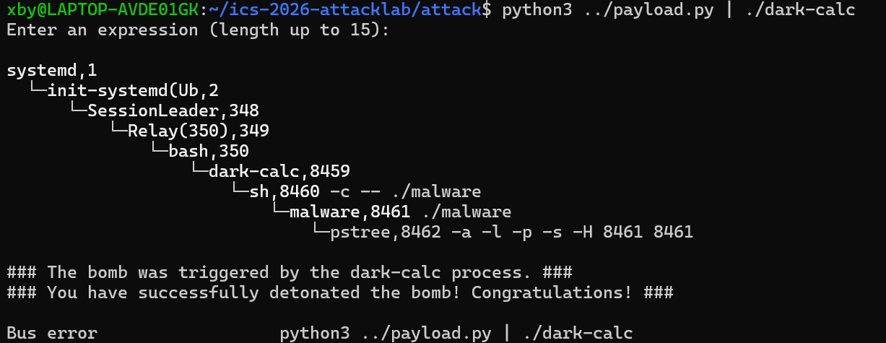
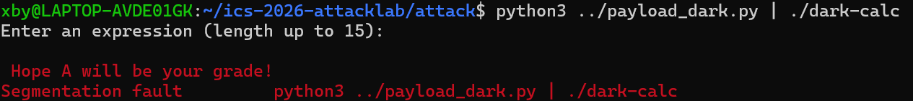
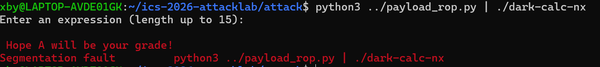
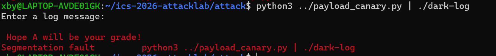

# Lab3 AttackLab 实验报告

姓名：徐邦予  学号：25300700058

## 任务1：观察栈帧 input

**1. input 函数是谁调用的？**
通过 GDB 的 trace 信息可知，`input` 函数由 `main` 函数调用。

**2. input 函数的前三条指令在做什么？`[rbp]` 的值来自哪里？**
前三条指令 `push rbp`、`mov rbp, rsp` 与 `sub rsp, 0x10` 属于函数的 prologue。其作用是保存调用者的栈基址、建立当前函数的栈帧，并为局部变量（`expression` 数组，16字节）分配空间。此时 `[rbp]` 中保存的是 `main` 函数的 `rbp`，该值由 `push rbp` 指令压栈产生。

**3. `[rbp + 8]` 处存的值是什么？**
`[rbp + 8]` 处存储的值为 `0x401ad1`，对应 `<main+0x0e> mov eax, 0x0` 指令，即 `input` 函数执行完毕后的返回地址。

**4. 哪一行汇编代码在 `[rbp + 8]` 处存入了值？**
`main` 函数中 `0x401acc <main+9> call 0x401977 <input>` 处的指令。`call` 执行时会将下一条指令的地址（`0x401ad1`）压入栈中，从而写入 `input` 栈帧的 `[rbp + 8]` 位置。

**5. call、prologue、leave 和 ret 的作用**
- `call`：将返回地址压栈，并跳转至目标函数。
- `prologue`：保存调用者的 `rbp`，建立当前函数的栈帧，为局部变量分配空间。
- `leave`：等价于 `mov rsp, rbp; pop rbp`，用于销毁当前栈帧，恢复调用者的 `rbp`。
- `ret`：从栈顶弹出返回地址至 `rip`，将控制流交还给调用者。

## 任务2：不同长度字符串测试

在 `dark-calc` 中，`expression` 缓冲区大小为 16 字节。
- 输入 20 个字符（实际写入 21 字节）：程序未发生崩溃。溢出的数据覆盖了 `[rbp]` 处保存的旧 `rbp`（低 4 字节变为 `0x41414141`），但未触及 `[rbp + 8]` 的返回地址，函数能正常返回。
- 输入 32 个字符（实际写入 33 字节）：程序触发 `Segmentation fault`。溢出数据覆盖了 `[rbp + 8]` 处的返回地址（8 字节变为 `0x4141414141414141`），导致 `ret` 跳转至非法地址。
通过 GDB 在 `gets` 返回后断点观察，确认超量数据自低地址向高地址依次覆盖了缓冲区、旧 `rbp` 与返回地址。

## 任务3：利用缓冲区漏洞执行 ./malware

**攻击流程**：
`input` 函数内的 `strcpy(command_buf, expression)` 存在未检查长度的栈溢出漏洞。正常执行流中，`eval` 函数会在 `command_buf` 两侧拼接 `echo $((` 和 `))`。
逆向分析 `eval` 函数可知，`0x401a6b` 处的指令为 `mov edi, 0x6030d0`，其后直接调用 `system`。Payload 构造策略为：将 `./malware\0` 写入 `command_buf`，并填充数据覆盖返回地址至 `0x401a6b`。此跳转绕过了字符串拼接步骤，使 `system` 直接执行 `./malware`。

## 任务4：用 GDB 检查 main 函数的机器码

- **机器码对照**：
  - `push rbp` 对应 `55`（1 字节）
  - `mov rbp, rsp` 对应 `48 89 e5`（3 字节）
  - `mov eax, 0x0` 对应 `b8 00 00 00 00`（5 字节）
- **内存排列**：x86-64 架构采用小端序，机器码按指令顺序自低地址向高地址连续排列。经 GDB 单步执行验证，`rip` 寄存器依次从 `0x401ac3` 前进至 `0x401ac4`、`0x401ac7`、`0x401acc`，分别对应上述指令的字节长度。

## 任务5：栈空间执行

**攻击流程**：
`grade_eval` 函数接收一个整型参数，仅当参数为 4 时输出 `Hope A will be your grade!`。由于目标程序通过 `init_fixed_stack` 固定了栈地址，ASLR 在此场景下未生效。
Payload 策略：在缓冲区写入 12 字节 Shellcode（`mov edi, 4`; `mov eax, 0x401a87`; `jmp rax`），并将返回地址覆盖为缓冲区的绝对地址 `0x721000800fd0`。控制流劫持后，栈上代码将寄存器参数设置完毕后直接跳转至 `grade_eval`，成功输出目标字符串。

## 任务6：ROP

**攻击思路**：
`dark-calc-nx` 开启了 NX（栈不可执行），且受 ASLR 影响。利用非 PIE 程序的代码段地址不变的特性，采用 ROP 技术。
通过分析 `__libc_csu_init` 的汇编，在 `0x401a33` 处找到 `pop rdi; ret` gadget。Payload 结构：24 字节填充 + `pop rdi; ret` 地址 + 参数值 `4` + `grade_eval` 地址（`0x401978`）。此链构造无需依赖栈的绝对地址，规避了 ASLR 防护。

## 任务7：Canary

**绕过思路**：
`dark-log` 启用了 Stack Protector。分析 `input` 函数可知，程序先通过 `gets` 读入 `rbp-0x120` 处的缓冲区，随后读取 `rbp-0x20` 处的值作为偏移量，将前 120 字节复制至 `rbp-0xa0 + 偏移量` 处。
偏移量位置距离缓冲区起始地址相距 256 字节（`0x120 - 0x20`）。将前 256 字节数据的末尾 4 字节设置为 `0xa8`，即可使数据复制目标指向 `[rbp+8]`（返回地址）。此操作完全避开了 `[rbp-8]` 处的 Canary 校验。
覆盖后的返回地址指向 ROP 链。由于无直接可用的 `pop rdi; ret`，选取 `__libc_csu_init` 中 `0x4018a3` 处的等价 gadget，设置 `edi=4` 并调用 `grade_eval`（`0x401677`）。

**防御思考题**：
防御此类攻击的有效方式是重排局部变量在栈中的布局。应确保 Canary 位于所有字符缓冲区与返回地址之间（即缓冲区在低地址，Canary 在高地址且紧邻返回地址），并限制索引拷贝操作的最大边界。这样任何向高地址方向的溢出都会先破坏 Canary，触发校验失败。